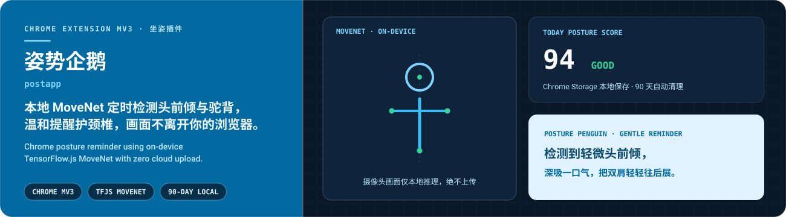
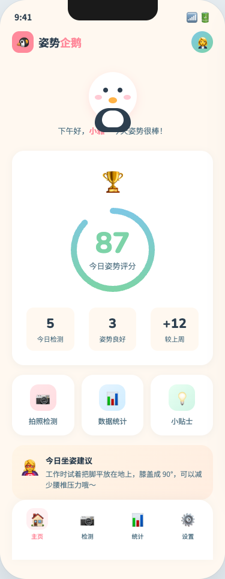
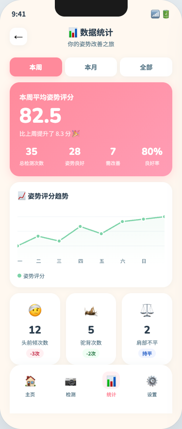
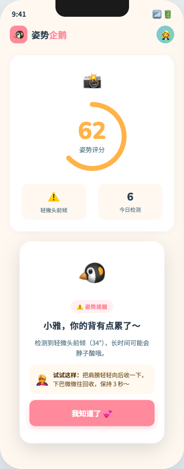

# Posture Penguin（姿势企鹅 / postapp）｜Chrome 坐姿提醒插件

<!-- hero:start -->

<p>
  <a href="https://github.com/ouxxyy/ouba-classmate"></a>
</p>

**完全在浏览器本地运行 TensorFlow.js MoveNet 实时检测驼背与头前倾，用温和企鹅动效提醒调整坐姿，摄像头画面不上传任何服务器。**  
<sub>On-device Chrome extension detecting slouching via local TensorFlow.js MoveNet with zero server uploads and gentle penguin reminders.</sub>

<p>
  <a href="https://github.com/ouxxyy/ouba-classmate"></a>
  <a href="#quick-example"></a>
  <a href="#quick-start"></a>
  <a href="#english-overview"></a>
  <a href="https://github.com/ouxxyy"></a>
</p>


<!-- hero:end -->

**一个在浏览器里帮你盯坐姿的 Chrome 插件**：定时用摄像头检测你的坐姿，发现驼背、头前倾就派一只小企鹅来温柔提醒——所有画面都在你电脑本地处理，一张也不会上传。

[](LICENSE)

---

> [!TIP]
> 🎁 扫码关注公众号「欧八同学」，免费领取 AI 案例与 Skill《大厂产品AI经验编程 200 套》→ [去扫码](#author)

[使用示例](#quick-example) · [开始使用](#quick-start) · [English](#english-overview)

<a id="quick-example"></a>

## 一次使用示例

**使用示例：** 从源码构建并加载扩展，允许摄像头权限，设置检测间隔，再在日常电脑工作中接收坐姿提醒。

**输出：** 插件在本机做姿态检测，用企鹅动画与音效提醒，并在浏览器里保存姿势记录。下方预览图是 UI 设计稿，不作为实际检测效果或健康改善的证据。

[查看源码安装步骤](#quick-start)。仓库名 `postapp`、英文产品名 Posture Penguin 和中文名“姿势企鹅”指同一个项目。

## 🖼 界面预览

> 以下为 UI 设计稿截图（来自 `design-assets/ui-mockups.html`），实际界面以扩展为准。

| 主页 · 姿势评分 | 检测 · 实时提醒 |
| :---: | :---: |
|  |  |
| **统计 · 趋势与报告** | **提醒 · 企鹅出场** |
|  |  |

---

## 🎯 为什么需要姿势企鹅？

长时间坐在电脑前，很容易不知不觉就头前倾、驼背、坐姿歪斜——等你发现时，脖子和腰已经酸了。

姿势企鹅的做法很直接：**定时拍一张照，本地 AI 判断坐姿，坐歪了就让小企鹅出来提醒你**。没有后台进程、没有账号、没有云端，关掉浏览器它就休息。

---

## ✨ 功能特性

| 功能 | 说明 |
| --- | --- |
| ⏰ **定时姿势检测** | 按你设定的间隔自动拍照，检测坐姿状态 |
| 🤖 **本地 AI 识别** | TensorFlow.js MoveNet（Lightning）推理，图像不离开你的电脑 |
| 🔔 **温柔提醒** | 小企鹅动画 + 柔和音效，提醒一次就走，不打断工作 |
| 📊 **数据统计** | 姿势评分趋势图、周报 / 月报 |
| 🖼 **打卡海报** | 一键生成带企鹅的坐姿打卡海报 |
| 🔒 **隐私保护** | 不上传任何图像或数据，记录只存在本地 Chrome Storage，90 天后自动清理 |

---

<a id="quick-start"></a>

## 🛠 安装

> 姿势企鹅目前**尚未上架 Chrome Web Store**，请先从源码安装（约 5 分钟）。

### 普通用户：加载扩展

1. 克隆仓库并构建：

   ```bash
   git clone https://github.com/ouxxyy/postapp.git
   cd postapp/posture-penguin
   npm install
   npm run build
   ```

2. 打开 Chrome，访问 `chrome://extensions/`
3. 开启右上角的 **「开发者模式」**
4. 点击 **「加载已解压的扩展程序」**，选择 `posture-penguin/dist` 目录
5. 工具栏出现企鹅图标后，点开它，允许摄像头权限，设置检测间隔即可开始

### 开发者

```bash
cd posture-penguin
npm run dev         # 开发构建（watch 模式）
npm run type-check  # TypeScript 类型检查
npm run build       # 生产构建
```

---

## 🔒 隐私说明

- ✅ 所有图像处理均在**浏览器本地**完成（TensorFlow.js 本地推理）
- ✅ 不上传任何图像或视频数据，没有账号、没有统计埋点
- ✅ 姿势记录仅存储在本地 `chrome.storage`，90 天后自动清理（每天定时执行）
- ✅ 详细政策见 [posture-penguin/PRIVACY_POLICY.md](posture-penguin/PRIVACY_POLICY.md)（[English](posture-penguin/PRIVACY_POLICY_EN.md)）

---

## 📁 项目结构

```
postapp/
├── posture-penguin/     # Chrome 扩展（React 18 + TypeScript + Webpack 5，Manifest V3）
│   ├── src/             # 源代码：popup / background / content / offscreen / 核心算法
│   ├── dist/            # 构建产物（可直接加载到 Chrome）
│   └── PRIVACY_POLICY.md
├── design-assets/       # UI 设计稿与设计规范（README 预览图来自这里）
└── assets/              # 仓库公开素材
```

---

## 🧠 技术栈

| 技术 | 用途 |
| --- | --- |
| React 18 + TypeScript | 界面开发 |
| Webpack 5 | 构建打包 |
| TensorFlow.js MoveNet（Lightning） | 本地姿势识别 |
| Recharts | 数据可视化 |
| Chrome Extension Manifest V3 | 浏览器扩展平台 |

---

## 🐛 反馈

遇到问题提 [Issue](https://github.com/ouxxyy/postapp/issues) 时，附上 Chrome 版本、操作系统和报错截图就够了；**请不要上传含真人面部的截图**，普通界面截图即可。

---

## 常见问题

### 可以直接在 Chrome Web Store 安装吗？

目前未上架。需要按源码安装步骤构建，再加载已解压的扩展程序。

### 摄像头画面会上传吗？

图像通过 TensorFlow.js MoveNet 在本机处理；姿势记录保存在本地 Chrome Storage，按项目规则清理。

### 它能治疗颈椎问题或保证矫正坐姿吗？

不能作这样的承诺。它提供坐姿提醒和行为记录，不提供医疗诊断或治疗。

<a id="english-overview"></a>

## English overview

Posture Penguin (姿势企鹅; repository name: postapp) is a Chrome posture reminder extension using on-device pose detection and local posture records. Camera frames are processed locally with TensorFlow.js MoveNet.

See [source installation](#quick-start): it is not currently listed in the Chrome Web Store, so build it and load the unpacked extension. Camera permission is required. The preview images are UI mockups, not validation of detection accuracy or medical benefit.

<!-- suite-matrix:start -->

## 更多开源项目 · More from ouba-classmate Suite

> 如果这个项目帮到了你，欢迎去旗舰合集仓 [**`ouxxyy/ouba-classmate`**](https://github.com/ouxxyy/ouba-classmate) 点一颗 Star 或一行安装全部 Skills：
> `npx skills add ouxxyy/ouba-classmate` · `gh api -X PUT /user/starred/ouxxyy/ouba-classmate`

| 仓库 · Repo | 分类 · Category | 它做什么 · What it does |
| --- | --- | --- |
| [`ouba-classmate`](https://github.com/ouxxyy/ouba-classmate) | SUITE · 旗舰合集 | **11 个原创项目总仓 + 一键安装全部 Skills + 在线战力测算与防身情报库**<br><sub>All-in-one Skills suite & benchmark</sub> |
| [`jd-resume-match`](https://github.com/ouxxyy/jd-resume-match) | CAREER · 求职涨薪 | **AI 简历优化与 JD 匹配体检（确定性公式 + 行号证据）**<br><sub>Deterministic JD matching & line-cited resume audit</sub> |
| [`ai-interviewer`](https://github.com/ouxxyy/ai-interviewer) | CAREER · 求职涨薪 | **中文语音/文字原话追问 AI 模拟面试官（含在线版）**<br><sub>Chinese voice AI mock interviewer anchored to your answers</sub> |
| [`job-search`](https://github.com/ouxxyy/job-search) | CAREER · 求职涨薪 | **跨 5 平台实时去重筛岗，输出带来源短名单**<br><sub>5-platform source-backed job search & shortlist builder</sub> |
| [`sherlock-company`](https://github.com/ouxxyy/sherlock-company) | CAREER · 求职涨薪 | **入职前四态证据公司背调与 Offer 核实清单**<br><sub>Pre-offer employer research with 4-state evidence boundaries</sub> |
| [`mbai`](https://github.com/ouxxyy/mbai) | CAREER · 求职涨薪 | **工作任务 AI 不可替代指数与 4 核决策复盘**<br><sub>Task-level AI irreplaceability index & decision reflection</sub> |
| [`codex-gif-video`](https://github.com/ouxxyy/codex-gif-video) | CREATIVE · AI 创作 | **69 种风格原生 GIF 与静音 MP4 素材生成 Skill**<br><sub>Native GPT Image 2.6 animated GIF & MP4 generator (69 styles)</sub> |
| [`storyboard-scavenger`](https://github.com/ouxxyy/storyboard-scavenger) | CREATIVE · AI 创作 | **可灵/即梦/Veo/Sora 七要素 AI 视频分镜工作流**<br><sub>7-element AI video storyboard skill for Kling & Seedance</sub> |
| [`travel-art-album-skill`](https://github.com/ouxxyy/travel-art-album-skill) | CREATIVE · AI 创作 | **旅行照片艺术画册与单文件离线翻页相册 Skill**<br><sub>Art-styled travel photo proofs & standalone offline HTML flipbook</sub> |
| [`mystery-skill`](https://github.com/ouxxyy/mystery-skill) | COGNITION · 认知框架 | **Mystery 认知框架与职场心理博弈分析 Skill**<br><sub>Cognitive framework for interview frame & decision study</sub> |
| [`Attention`](https://github.com/ouxxyy/Attention) | LOCAL APP · 本地工具 | **ActivityWatch 本地专注力、心流时段与切换分析**<br><sub>Local ActivityWatch focus & context-switching dashboard</sub> |
| [`postapp`](https://github.com/ouxxyy/postapp) · **Current** | LOCAL APP · 本地工具 | **Chrome 本地摄像头姿态检测与坐姿提醒插件**<br><sub>On-device MoveNet Chrome posture reminder extension</sub> |

<!-- suite-matrix:end -->

<a id="author"></a>

## 👤 作者

作者全平台同名：**欧八同学**。

- 个人主页 / 联系我：[albertou.redboook.cn](https://albertou.redboook.cn/)
- 微信公众号：扫码关注，免费领取 AI 案例与 Skill《大厂产品AI经验编程 200 套》
- 抖音：[搜索“欧八同学”](https://www.douyin.com/search/%E6%AC%A7%E5%85%AB%E5%90%8C%E5%AD%A6)
- 小红书：[搜索“欧八同学”](https://www.xiaohongshu.com/search_result?keyword=%E6%AC%A7%E5%85%AB%E5%90%8C%E5%AD%A6)
- X：[搜索“欧八同学”](https://x.com/search?q=%E6%AC%A7%E5%85%AB%E5%90%8C%E5%AD%A6&src=typed_query)

<p align="center">
  
</p>

<p align="center"><sub>扫码关注「欧八同学」，免费领取《大厂产品AI经验编程 200 套》</sub></p>

如果这个项目对你有用，欢迎点个 Star 🐧

---

## 📄 开源协议

[MIT License](LICENSE) —— 欢迎 fork、提交 PR。

---

**姿势企鹅** —— 用温柔的方式，让你慢慢变好 🐧

<!-- footer:start -->

<p align="center">
  <a href="https://github.com/ouxxyy"></a>
</p>

<!-- footer:end -->
